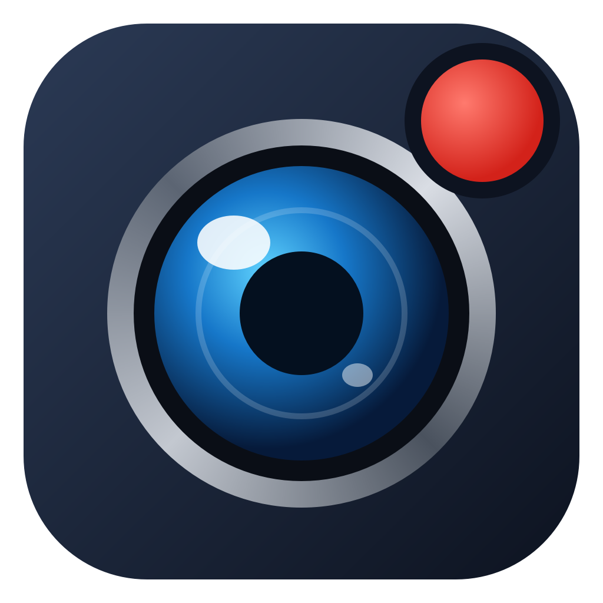

# Camera Viewer

A Windows app to view and record several USB cameras (Arducam and any other UVC webcam) at once,
built for behavioural experiments.

## Features

- **Live view of many cameras.** Tick the cameras to show; they tile automatically
  (1 → 1×1, 2 → 2×1, 3 → 3×1, 4 → 2×2, 5–6 → 3×2 …) in one window with draggable dividers,
  or as separate windows.
- **Per-camera resolution and frame rate**, using the modes each camera reports.
- **Adjustments (⚙ on each camera):** camera settings such as exposure, gain, brightness,
  contrast, gamma and white balance, plus software filters (brightness, contrast, gamma,
  saturation, vibrance). Remembered per camera.
- **Synchronized recording** of one or several cameras on a shared clock, with a time limit,
  a per-camera recording frame rate, and a choice of which filters go into the video.
- **Per-frame timestamps** (`_timestamps.csv`) next to every video, for aligning cameras.
- **TTL trigger:** start (and optionally stop) recordings from an Arduino or a Harp board.
  Edges are logged to `_ttl_events.csv`.
- **Live size estimate:** GB per hour per camera, and how long your free disk space lasts.

## Video formats

All recordings are `.avi`.

| Format | What it does | 1080p30 arena, Standard |
|---|---|---|
| **H.264** (default) | Stores a full frame every 10 s and only the changes in between. Uses an NVIDIA graphics card when available, otherwise the CPU. | ~0.4–1.5 GB/h |
| **MPEG-4** | The codec Bonsai writes (FMP4). Very light on CPU. | ~0.7–1.6 GB/h |
| **MJPEG** | Every frame stored as its own JPEG. Best for frame-by-frame image analysis. | ~15–33 GB/h |

Quality presets are **High / Standard / Compact**.

## Running it

- **Easiest:** download `CameraViewer.exe` from the
  [Releases](../../releases) page and double-click it. No installation needed.
- **From source:** install Python 3.11, then run `build_exe.bat`. It sets up a `.venv` with
  everything in `requirements.txt` and builds `CameraViewer.exe` next to it. To run without
  building: `.venv\Scripts\python camera_viewer.py`.

Close other programs that use the cameras (the Arducam app, OBS, Bonsai) first.
A camera can only be used by one program at a time.

## TTL trigger wiring

**Arduino:** flash `ttl_trigger/ttl_trigger.ino`. Connect the TTL signal to pin 2 and its ground
to GND. In the app, pick *Arduino (serial)*, the board's COM port, then **Connect**. In the Record
window choose *Wait for TTL trigger*. 5 V boards (Uno, Nano) accept 3.3 V and 5 V TTL.

**Harp:** pick *Harp device*, its COM port, and the register/bit of the digital input (check your
board's register map). The app can't share the port with Bonsai. If Bonsai controls the board,
route a Harp digital output into an Arduino running the sketch instead.

**Test ↑ / Test ↓** simulate edges, so you can try the workflow without hardware.

## Files

| File | Purpose |
|---|---|
| `camera_viewer.py` | The app |
| `build_exe.bat` | Sets up Python packages and builds `CameraViewer.exe` |
| `requirements.txt` | Python packages and versions |
| `ttl_trigger/ttl_trigger.ino` | Arduino sketch: TTL edges → serial |
| `make_icon.py`, `app_icon.*` | App icon (re-run `make_icon.py` after editing it) |

## Credits

Written by [your name]. Built with help from Claude (Anthropic).
